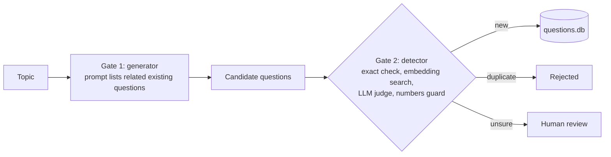

# question-dedup: AI question generation with duplicate prevention

This project uses an LLM (a large language model, here Google Gemini) to write new exam questions
for a question bank. It tries hard not to add a question that the bank already has.
It does this with **two gates**: the generator is shown what already exists (gate 1), and every new
question is then checked by an independent duplicate detector (gate 2) before it is saved.
The questions and their tags are kept in a small SQLite database file.

This is **version 1** (git tag `v1-two-gate`). The full write-up is in [REPORT.md](REPORT.md).

## The two-gate idea



Gate 1 lowers the number of duplicates the LLM writes. It can still slip, so gate 2 is the safety net.

## Setup (Windows, PowerShell)

```powershell
python -m pip install -r requirements.txt
$env:GEMINI_API_KEY="your-key-here"
```

- Windows note: if Smart App Control blocks `pip` or PyTorch, always use `python -m pip ...`.
  PyTorch (needed by `sentence-transformers`) only runs with Smart App Control turned off.
- The first run downloads the small embedding model `all-MiniLM-L6-v2` from Hugging Face.
  A warning about a missing `HF_TOKEN` is normal and can be ignored.

## Quick start

```powershell
python load_seed.py        # put the 10 seed questions into questions.db
python build_clusters.py   # group the questions into clusters
python demo.py             # demo on its own demo.db: tags, 10 detector cases, a small generation run
python run_generate.py     # generate 5 new questions on "reflection of light" into questions.db
```

`python demo.py --no-generate` skips the generation part (no generation call to the LLM).

## Folder map

| Path | What is there |
|---|---|
| `*.py` (top level) | the core code: `normalize`, `embed`, `llm`, `judge`, `store`, `clusters`, `detector`, `backfill`, `build_clusters`, `load_seed`, `generator`, `run_generate`, `demo` |
| `data/` | seed questions, labelled test pairs, fresh held-out pairs, public QQP and PAWS samples |
| `experiments/` | evaluation, benchmark and exploration scripts |
| `experiments/judge_caches/` | saved judge verdicts, so evaluations can be re-run without calling the LLM |
| `results/` | the saved output of every run, and `SUMMARY.md` (the lab notebook) |
| `*.db` | SQLite databases (not in git): `questions.db` (10 seed questions), `questions_dev_43.db` (development bank), `demo.db`, and backups |

## Headline results

| What | Result | File |
|---|---|---|
| Final design on 60 labelled pairs | precision 1.00, recall 0.97, 1 missed, 0 false alarms, 53 judge calls | `results/final_pairs_guard_on.txt` |
| Held-out test on 26 fresh pairs (chapters never used for tuning) | precision 1.00, recall 0.93, 1 missed, 0 false alarms, 24 judge calls | `results/fresh_heldout_final.txt` |
| Demo: exact, semantic and different questions | 10 of 10 cases as expected | `results/demo_output.txt` |
| Embedding-only baseline on the same 60 pairs (line 0.80) | precision 0.73, recall 0.84, 10 false alarms | `results/final_pairs_guard_on.txt` |

Precision = of the pairs flagged as duplicates, the share that really were. Recall = of the real duplicates, the share that were caught.
Known weak spots (word-order traps, paraphrases that need world knowledge, rate limits) are in REPORT.md, section 12.
