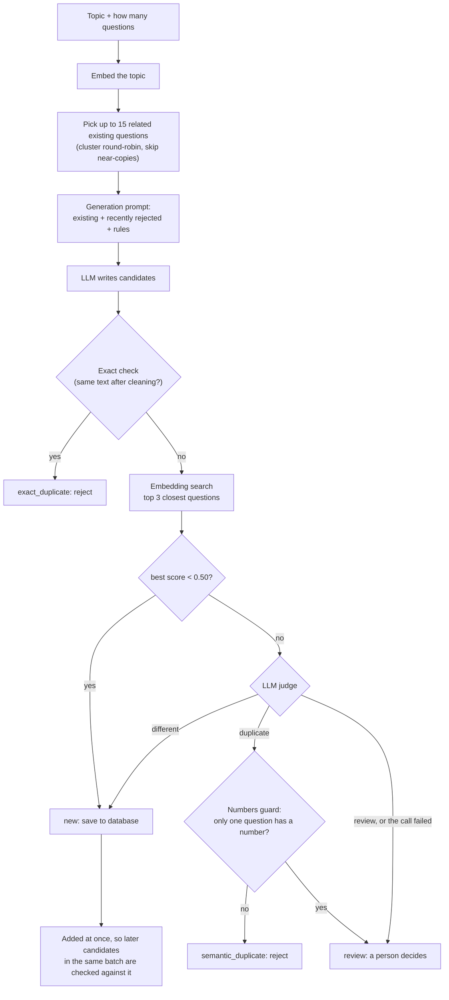

# REPORT: AI question generation and duplicate prevention (version 1)

This report explains what the system does, how it was built, how it was tested, and where it is weak.
Every number has the name of the file in `results/` that it comes from.
When a number was worked out by hand from other numbers, it says "computed".

Version 1 is frozen as the git tag `v1-two-gate`.

---

## 1. Problem and goals

We want an LLM to write new exam questions for a question bank, without filling the bank with duplicates.

An **LLM** (large language model) is an AI model that reads and writes text. Here it is Google's
`gemini-3.5-flash-lite`, called through the `google-genai` Python package.

A **duplicate** here means: a student would need the same knowledge and would give the same kind of
answer to both questions. "What is reflection of light?" and "Define the reflection of light." are duplicates.
"What is the angle of reflection?" and "What is the angle of incidence?" are not.

The system has **two gates**:

1. **Gate 1, prevention (at generation time).** Before the LLM writes questions, the prompt shows it the
   related questions that already exist and asks it to write different ones.
2. **Gate 2, detection (before saving).** Every new question goes through an independent duplicate detector.
   Only questions that pass are saved.

**Why both?** Prevention alone is not enough. The LLM does not always follow instructions, and the prompt
can only show a small part of a big bank. For example, in the first generator run the LLM suggested
"Calculate the number of images formed when an object is placed between two plane mirrors inclined at an
angle of 60 degrees to each other", although a question like this (Q13) was already in the bank. The
detector rejected it as a duplicate of Q13 (`final_generate.txt`). Detection is the safety net.
Detection alone would also work, but it would waste many LLM calls on candidates that are rejected.

## 2. Architecture

| Module | What it does |
|---|---|
| `normalize.py` | Cleans text (lower case, no punctuation, single spaces) and makes a SHA-256 hash of it. |
| `embed.py` | Turns text into 384 numbers with the `all-MiniLM-L6-v2` model. |
| `llm.py` | Sends a prompt to Gemini and reads back JSON. Waits and retries on temporary errors. |
| `judge.py` | The judge prompt: asks the LLM if a new question duplicates any of its closest neighbours. |
| `store.py` | The SQLite database: save and load questions, tags, embeddings, clusters. Configurable path. Tag filter. |
| `clusters.py` | A small k-means (groups similar vectors) written with numpy, plus a clustered search index. |
| `detector.py` | Gate 2: exact check, embedding search, judge, numbers guard. Switches from brute force to clusters at 50,000 questions. |
| `backfill.py` | Fills in missing embeddings for questions saved without one. |
| `build_clusters.py` | Builds about sqrt(n) clusters and saves them. |
| `load_seed.py` | Loads the 10 seed questions from `data/seed_questions.json`. |
| `generator.py` | Gate 1 + the generation loop. Every candidate goes through the detector. |
| `run_generate.py` | Runs the generator for "reflection of light", 5 questions. |
| `demo.py` | Shows tags, 10 detector cases and a small generation run on its own `demo.db`. |
| `experiments/` | Evaluation and benchmark scripts. They are not needed to run the system. |

## 3. Data model and tags

All questions live in one SQLite table. **SQLite** is a database stored in a single file; it needs no server.

| Column | Type | Meaning |
|---|---|---|
| `id` | TEXT, primary key | Question id, such as `Q7` |
| `text` | TEXT | The question as written |
| `normalized_text` | TEXT | The cleaned text used for the exact check |
| `text_hash` | TEXT, indexed | SHA-256 hash of the cleaned text |
| `tags` | TEXT | JSON key–value pairs, such as `{"subject": "physics", "chapter": "light"}` |
| `embedding` | BLOB | The 384 embedding numbers, saved as bytes |
| `cluster_id` | INTEGER, indexed | Which cluster the question belongs to |

A second table, `centroids`, stores the centre of each cluster.

**Tags** are stored as a JSON text, so each question can have any keys it needs.
A new key needs no change to the table. In the demo, Q7 has an extra key `"type": "numerical"`,
Q8 has no `"chapter"` key, and a new question is added with a brand-new key `"difficulty": "easy"`.
All three work with no table change (`demo_output.txt`, Part A).

`store.get_questions_by_tags({"chapter": "light"})` returns the questions whose tags contain all the
given key–value pairs. It filters in Python after loading the rows. That is fine for a small bank;
for a big one you would filter inside SQLite with `json_extract` or add an index.

**Tags only organise and filter. They never decide duplicates.** I checked the code: `detector.py` and
`judge.py` never read tags, and `store.load_all_with_embeddings()`, which feeds the detector, does not
even load the tags column. Only `store.py`, `load_seed.py`, `generator.py`, `run_generate.py` and
`demo.py` touch tags. The reasons:

- Tags can be missing. Q8 "What is reflection?" has no chapter tag. A tag-based filter would never
  compare it with the light questions (`demo_output.txt`, Part A: the chapter filter returns 9 questions, without Q8).
- Tags can be inconsistent. The same question might be tagged `physics/light` by one person and
  `science/optics` by another. Demo case 10 sends the exact text of Q1 with the tags
  `{"subject": "science", "chapter": "optics"}`. The detector only receives the text, so it still finds
  the exact duplicate of Q1 (`demo_output.txt`, Part B).

## 4. Gate 1: avoiding duplicates at generation time

**Problem:** the prompt cannot list the whole bank. A bank of thousands of questions would not fit in the
LLM's context (the amount of text it can read at once), and it would cost a lot.

**How related questions are picked** (`generator.related_questions`):

1. Embed the topic (for example "reflection of light") into 384 numbers.
2. Score every question in the bank against the topic (cosine similarity, explained in section 5).
3. If clusters exist, order the clusters by how close their centre is to the topic. Inside each cluster,
   order the questions by score.
4. Take questions **round-robin**: the best from cluster 1, then the best from cluster 2, and so on.
   This gives a mix of sub-topics instead of 15 near-copies of the same question.
5. Skip a question if it is 0.88 or more similar to one already picked (a near-copy adds nothing).
6. Stop at 15 questions (`CONTEXT_K = 15`).

In the demo, the bank had 11 questions but only 7 were sent, because the skip rule removed the
near-copies of "Define the reflection of light." (`demo_output.txt`, Part C).

**Prompt design** (`GEN_PROMPT` in `generator.py`):
- the list of related existing questions ("these ALREADY EXIST")
- the list of questions rejected earlier in this run, capped at the last 10 ("do not suggest them again")
- rules: do not reword anything listed; test a concept the existing questions do not test; make each new
  question different from the others in the list; use a mix of question types (definition, explanation,
  numerical, application, comparison, reasoning); stay strictly within the topic
- the reply must be JSON with `concept`, `type` and `question` for each question. Asking for the concept
  and type makes the LLM think about *what* each question tests, which helps it avoid repeats.

**The loop:**
- Ask for twice as many questions as still needed (oversample ×2), but never more than 10 in one batch.
  Some will be rejected, so asking for extra saves rounds.
- At most 3 rounds.
- Every candidate goes through gate 2. Accepted ones are added to the detector and the database **at once**,
  so the next candidate in the same batch is also checked against them. A batch is checked against itself.
- If the generation call fails, the generator prints one line, stops, and still prints the summary line.

**Why the prompt size stays fixed as the bank grows:** the prompt always holds at most 15 existing
questions and at most 10 rejected ones, whether the bank has 10 questions or 100,000.
Picking the 15 costs one embedding and one pass of multiply-and-add over the saved vectors, with no LLM call.

## 5. Gate 2: independent detection, layer by layer

The detector (`detector.py`) checks only the text of a question. It runs cheap layers first and the
expensive LLM only when needed.

### Layer 1: normalize + hash (exact check)

`normalize_text` does four things: Unicode clean-up (NFKC), lower case, every punctuation mark becomes a
space, and runs of spaces become one space. Then `make_hash` computes a **SHA-256 hash**, a fixed-length
fingerprint of the text. Two texts with the same fingerprint are the same after cleaning.
Looking up a hash is instant, and no LLM is needed.

Example (`exact_check.txt`): "DEFINE the reflection of light!!" and "   define   the   reflection of light "
both become "define the reflection of light" and match Q2 and Q10.

What is **deliberately not** normalized:
- **Numbers.** "The angle of incidence is 45°…" does not match the 30° question (`exact_check.txt`).
  Changed numbers might be a duplicate calculation, or not; the judge decides.
- **Small words like "not" or "cannot".** No words are removed, because "Name a mirror that can form a real
  image" and "…cannot form a real image" mean opposite things.
- **Word order and synonyms.** "Define reflection of light." does not match "Define the reflection of light."
  (the word "the" differs) (`exact_check.txt`). The exact check is strict on purpose; the next layers handle these.

### Layer 2: embedding search

An **embedding** is a list of numbers that represents the meaning of a text. Texts with similar meaning get
similar numbers. We use `all-MiniLM-L6-v2` (384 numbers per question). The vectors are normalised to length 1,
so the **cosine similarity** (how closely two vectors point the same way, from about 0 to 1 here) is just
the dot product. Example (`score_table_seed10.txt`): "Define reflection of light." scores 0.99 against
Q2/Q10, 0.94 against Q1, and 0.50 against the calculation question Q7.

The detector finds the **top 3** closest questions. If the best score is **below 0.50**, the question is
called **new** with no LLM call. Otherwise it goes to the judge.

### Layer 3: the LLM judge

The judge (`judge.py`) gets the new question and its 3 closest neighbours, each with its id, and must
reply with JSON: `verdict` ("duplicate", "different" or "review"), `duplicate_of` (an id) and a one-sentence
`reason`. Temperature is 0 (as little randomness as possible). The final rules, quoted from the prompt:

> A NEW question is a DUPLICATE of an existing question if a student would need the
> same knowledge and would give the same kind of answer to both.
>
> Treat these as DUPLICATES:
> - the same question asked in different words
> - the same calculation where only the numbers are changed
> - the same question with a small extra part added, such as asking for an example, a reason, or a diagram
>
> Treat these as DIFFERENT:
> - the same topic but a different concept or a different kind of answer
>   (for example a definition versus a calculation, or one law versus another)
> - questions about two different things of the same kind, or about opposite cases.
>   Changing a single key word can change the meaning completely.
> - a question that asks what something is (a definition or explanation) versus a
>   question that gives numbers and asks to calculate it. Adding numbers to a
>   definition question turns it into a calculation; this is not a small extra part.
>   For example "What is speed?" versus "A car travels 100 km in 2 hours. Find its speed."
>
> Answer "review" if the new question is too vague to decide,
> for example if a key word could have more than one meaning and the question gives no context.

### Layer 4: the numbers guard

If the judge says "duplicate" but only one of the two questions contains a digit, the result becomes
**review** instead. This targets definition-versus-calculation pairs, where the judge was not stable
(section 8). Example: Q7 "The angle of incidence is 30°. What is the angle of reflection?" against
Q6 "What is the angle of reflection?" becomes "review" by "numbers guard" (`final_regression_v2.txt`).

### Judge failure

If the judge call fails (for example, a rate limit after all retries), the result is **review**,
decided by "judge failed". The question is never saved or rejected without a decision.

### Output labels

| Label | Meaning | Decided by |
|---|---|---|
| `exact_duplicate` | same text after cleaning | exact |
| `semantic_duplicate` | same meaning | judge |
| `new` | not a duplicate | embedding (score < 0.50) or judge |
| `review` | a person should decide | judge, numbers guard, or judge failed |

### Why there is no "auto-duplicate" zone

An earlier design said "score ≥ 0.92 means duplicate, no judge needed". The data showed this is unsafe:
- Near-miss pairs score very high. "Name a mirror that can form a real image." vs "…cannot form a real image."
  scores 0.97 (W5), and the near-miss category goes up to 0.97 (`final_pairs_guard_on.txt`, section 1).
- In the fresh pairs, the opposite-case pairs score 0.99 to 1.00, for example "Light travels from glass into air…"
  vs "…from air into glass…" (`fresh_heldout.txt`, section 1).
- Every PAWS pair scores 0.91 or higher (`final_public_paws.txt`, section 1).

So a high score does not prove a duplicate. In the code the top line is `DUP_THRESHOLD = 1.01`, which no
score can reach. Only the exact check can mark a duplicate without the judge.

## 6. Scaling

**Saved embeddings.** Embedding takes 4.2 to 4.8 ms per question on this laptop (`benchmark_run1.txt` to
`benchmark_run3.txt`). Re-embedding the whole bank on every run would take 42 to 48 s for 10,000 questions and
424 to 477 s for 100,000 (same files). So each embedding is computed once and saved in the database.
`backfill.py` fills in any that are missing.

**Brute-force search** means comparing the new question with every saved question. With numpy it takes
(`benchmark_run1.txt` to `benchmark_run3.txt`; these times include sorting all scores):

| Bank size | Search time |
|---|---|
| 1,000 | 0.15 to 0.19 ms |
| 10,000 | 2.09 to 3.48 ms |
| 100,000 | 23.57 to 25.82 ms |

**Clustered search.** `clusters.py` has a small k-means. **k-means** groups vectors into k clusters; each
cluster has a centre. We use about sqrt(n) clusters (316 for 100,000). To search, we compare the question with
the cluster centres, then only search inside the `nprobe` closest clusters.

It was tested on 100,000 fake vectors (`benchmark_clusters.py`). The fake data is calibrated: you choose how
spread out the fake topics are, and the script prints the average similarity between two random fake questions,
so it can be compared with real questions. For reference, the average similarity between the 10 seed questions,
which are all on one chapter, is 0.72 (computed: the mean of the 45 pair scores in `score_table_seed10.txt`).
Each query is a bank vector plus noise (query noise 0.9).

| Setting | Avg. random similarity | Brute force | nprobe 1 | nprobe 2 | nprobe 5 | Source |
|---|---|---|---|---|---|---|
| spread 0.6 | 0.49 | 8.99 ms | 1.00 ms, found 185/200 | 3.96 ms, 195/200 | 9.42 ms, 200/200 | `benchmark_clusters_spread06.txt` |
| spread 0.4 | 0.58 | 9.19 ms | 1.21 ms, 166/200 | 1.92 ms, 177/200 | 5.40 ms, 192/200 | `benchmark_clusters_spread04.txt` |

"Found" = how often the clustered search returned the same closest question as brute force.
(Brute force here is about 9 ms instead of 24 ms because this script only takes the single best score instead of sorting.)

What this honestly shows:
- Clusters cut the work a lot: at nprobe 5 with spread 0.6, only 6,022 of 100,000 questions are checked
  on average (`benchmark_clusters_spread06.txt`).
- But in this pure-numpy code the time saving is small or none at nprobe 5, because gathering rows from
  several clusters costs time. Clusters are only clearly faster at nprobe 1 or 2, and then they sometimes miss the true closest match.
- When the data is more crowded (spread 0.4), clusters miss more often: 192/200 at nprobe 5.

**The decision.** Below 50,000 questions the detector uses brute force: it is exact and takes a few
milliseconds. At 50,000 and above, it switches to clusters with nprobe 5 (`CLUSTER_SWITCH_SIZE` and `NPROBE`
in `detector.py`). The switch is built in and tested: `test_switch.txt` runs the same 4 candidates with brute
force and with clusters (forced on, nprobe 1). Both gave the same labels, while the clustered search checked
8 or 1 questions instead of 10. Given the benchmark above, the 50,000 line is a design choice, not something the
timing proves; at that size even brute force is fast compared with one LLM call.

**Cluster rebuilds.** A new question is put in the cluster with the nearest centre. The centres are not updated,
so after many additions they drift away from the real groups. `build_clusters.py` should be re-run from time to time.

**Production options.** For a real large bank, use a vector index built for this: **FAISS** (a library for fast
similarity search, with its own clustered index) or **pgvector** (vector search inside PostgreSQL).

## 7. Technology choices

| Choice | Why | Alternative considered | Why not |
|---|---|---|---|
| SQLite | One file, no server, built into Python. Enough for this size. | PostgreSQL | Needs a server; not needed yet. pgvector would be the upgrade path. |
| `all-MiniLM-L6-v2` embeddings | Small, fast (4.2–4.8 ms per question, `benchmark_run*.txt`), runs offline, free. | Bigger embedding models or an embedding API | Slower or costs money. The embedding is only a filter; the judge decides. |
| numpy for search | Brute force is a few ms up to 100,000 (`benchmark_run*.txt`). Easy to read. | FAISS | Extra dependency; not needed at this size. Listed as the production option. |
| Own k-means | About 30 lines, easy to explain, shows how clustered search works. | FAISS IVF index | Faster and tested at scale, but hides the idea. Use it in production. |
| Gemini `gemini-3.5-flash-lite` as judge and generator | Cheap, fast, free tier, good JSON output. | `gemini-3.8-flash` (stronger) | Better on word-order traps: 3 false alarms instead of 9 on 18 PAWS pairs (`final_paws_model_compare.txt`). But the free tier allows only 20 calls per day for it (`strong_judge_paws_run4.txt`), so it could not be fully tested. |
| LLM judge for the final decision | Accurate: judge-only scores precision 0.97, recall 1.00 on 60 pairs (`final_pairs_guard_on.txt`). | Quora cross-encoder (`cross-encoder/quora-distilroberta-base`), a model that reads both questions together and gives one score | On our 60 pairs at line 0.5: precision 0.89, recall 0.53 (`step6_mistakes_by_approach.txt`). On the fresh pairs: recall 0.21 (`fresh_heldout_cross_encoder.txt`). It scores changed-number questions near 0. Rejected. |

## 8. How the design changed (with numbers)

1. **First thresholds from the 10 seed questions.** The first detector used two lines: score ≥ 0.92 means
   duplicate, score < 0.75 means new, and only the middle went to the judge. On the 10 seed questions it
   looked perfect. That early run's output was not saved, so its score is not repeated here.
   Ten questions are far too few to trust.
2. **The 60-pair test showed the auto-duplicate zone causes false alarms.** I wrote 60 labelled pairs in
   8 categories (section 9). With the old judge rules, the (0.92, 0.75) cascade scored precision 0.93,
   recall 0.78 on all 60, with 7 missed duplicates (`step6_mistakes_by_approach.txt`). Near-miss pairs like
   W5 (0.97) and W6 (0.94) passed the 0.92 line and became false alarms, although the judge got them right
   (`step1_stepA.txt`). No embedding line alone reached precision 0.90 (`step1_stepA.txt`).
3. **The standard "retrieve, then re-rank" pattern.** This is a common design in search systems: a cheap, fast
   method finds a few candidates (retrieve), and a slow, accurate method decides (re-rank). Here the embedding
   finds the top 3, and the judge decides. Tuning with the new rules pushed the top line up to 0.98, and later
   it was switched off completely (1.01).
4. **Judge rules, version 1 → 2.** The first rules missed changed-number and extra-part duplicates. Judge only,
   all 60: precision 0.97, recall 0.88, 4 missed (N1, X1, X3, X4) and 1 false alarm (W4)
   (`step7_mistakes_by_approach.txt`, `step6_mistakes_by_approach.txt`). Version 2 added "only the numbers changed = duplicate"
   and "small extra part = duplicate": recall 1.00, but 2 new false alarms, D1 and D7 (`step7_mistakes_by_approach.txt`).
5. **Version 2 → 3.** D1 is "What is the angle of reflection?" vs "The angle of incidence is 30°. What is the angle of
   reflection?". Version 3 added the definition-versus-calculation rule, with an example about speed so that it does not
   hand the judge the answer. Judge only, all 60: precision 0.97, recall 1.00, 1 false alarm (D7) (`step7_mistakes_by_approach.txt`).
6. **The judge is not stable on that pair.** The same pair, asked 6 more times, got "duplicate" 5 times
   (`step7_q7_diagnostic.txt`). The regression test still failed on Q7 (`step7_rule3_regression.txt`).
7. **Numbers guard.** Instead of more prompt changes, a simple code rule: "duplicate" + only one question has
   numbers → review. Q7 is now sent to a person instead of being rejected (`final_regression_v2.txt`).
   Final setting (1.01, 0.50) on all 60: precision 1.00, recall 0.97, 53 judge calls (`final_pairs_guard_on.txt`).

## 9. Evaluation method

**Datasets**

| Data | Size | What it is |
|---|---|---|
| `data/seed_questions.json` + `data/test_labels.json` | 10 questions | The first test set. Added one by one; each has an expected label (regression test). |
| `data/test_pairs.json` | 60 pairs (32 duplicate, 28 different; computed from the file) | Hand-labelled pairs in 8 categories: exact, paraphrase, numbers changed, extra part, other-subject paraphrase (duplicates); same topic different concept, near-miss wording, different topic (different). |
| Tune / test split | 30 + 30 | Even positions are the TUNE half (used to pick settings), odd positions the TEST half (only used to check). |
| `data/public_qqp.json`, `data/public_paws.json` | 50 + 50 pairs | Random samples of public datasets (`step5_make_public_pairs.txt`). QQP (Quora Question Pairs) calls questions duplicates only if they have the same intent. PAWS pairs use the same words in a different order; its "different" pairs are word-order traps. Both use their own idea of "duplicate", not ours. |
| `data/fresh_pairs.json` | 26 pairs (14 duplicate, 12 different) | Held-out pairs on chapters never used for tuning: refraction, lenses, the human eye, electricity. Run once. |

**Metrics** (all treat "duplicate" as the positive class)
- **Precision**: of the pairs flagged as duplicates, how many really were.
- **Recall**: of the real duplicates, how many were caught.
- **Missed**: real duplicates let through. **False alarms**: different questions wrongly flagged.
- **Review count**: how many went to a person.
- **Judge calls**: how many LLM calls were needed. This is the main cost.
- **"Review" counts as caught.** A question sent to review is not saved automatically, so for a real duplicate
  that is a catch. For a different question it counts as a false alarm.

**Performance** is measured two ways: timing (benchmarks, section 6) and judge calls (cost and rate limits).

**Saved verdicts.** Each judge verdict is saved in `experiments/judge_caches/judge_cache.json`, tagged with a
version made from the prompt and model. Re-running an evaluation reuses the saved verdicts and makes no new
calls, unless the prompt or model changed.

## 10. Results

### 10.1 Final design on the 60 labelled pairs

Source: `final_pairs_guard_on.txt`, section 6.

| Pairs | Precision | Recall | Missed | False alarms | Review | Judge calls |
|---|---|---|---|---|---|---|
| All 60 | 1.00 | 0.97 | 1 | 0 | 0 | 53 |
| TEST half (30) | 1.00 | 0.94 | 1 | 0 | 0 | 27 |

The only mistake is C4, "Who wrote the Indian national anthem?" vs "Name the author of Jana Gana Mana."
(score 0.39, below the 0.50 line) (`final_pairs_guard_on.txt`, section 7).

### 10.2 Comparison of approaches (all 60 pairs, current judge rules unless noted)

| Approach | Precision | Recall | Missed | False alarms | Judge calls | Source |
|---|---|---|---|---|---|---|
| Embedding only, line 0.80 | 0.73 | 0.84 | 5 | 10 | 0 | `final_pairs_guard_on.txt` |
| Cross-encoder alone, line 0.5 | 0.89 | 0.53 | 15 | 2 | 0 | `step7_mistakes_by_approach.txt` |
| Cross-encoder gate + judge (D3: HIGH 0.8, LOW 0.05) | 1.00 | 0.72 | 9 | 0 | 15 | `step7_mistakes_by_approach.txt` |
| Old cascade (0.92, 0.75) | 0.94 | 0.91 | 3 | 2 | 34 | `final_pairs_guard_on.txt` |
| Judge only | 0.97 | 1.00 | 0 | 1 | 56 | `final_pairs_guard_on.txt` |
| Judge only, rule version 1 | 0.97 | 0.88 | 4 | 1 | 56 | `step7_mistakes_by_approach.txt` |
| **Final (1.01, 0.50) + numbers guard** | **1.00** | **0.97** | **1** | **0** | **53** | `final_pairs_guard_on.txt` |

### 10.3 Regression test (10 seed questions, added one by one)

**Correct 9/10, 8 judge calls** (`final_regression_v2.txt`; repeated with the same result after the folder
clean-up in `verify_after_cleanup.txt`). The one "wrong" is Q7, which becomes "review" by the numbers guard.
The expected label is "new", so the script counts it as wrong, but "review" is the intended safe result.

### 10.4 Public data (judge with current rules)

Source: `final_public_qqp.txt` and `final_public_paws.txt`, section 6. Final setting (1.01, 0.50), guard on, all 50 pairs.

| Data | Precision | Recall | Missed | False alarms | Review | Judge calls |
|---|---|---|---|---|---|---|
| QQP | 0.77 | 1.00 | 0 | 5 | 1 | 32 |
| PAWS | 0.60 | 1.00 | 0 | 16 | 0 | 50 |

Both catch every duplicate but give many false alarms. On QQP part of this is the definition gap: our rule
"small extra part = duplicate" disagrees with QQP's "same intent". On PAWS it is a real weakness (section 12).

### 10.5 Held-out fresh pairs (26 pairs, run once)

Source: `fresh_heldout_final.txt`, section 1.

| Approach | Precision | Recall | Missed | False alarms | Review | Judge calls |
|---|---|---|---|---|---|---|
| Final (1.01, 0.50) + guard | 1.00 | 0.93 | 1 | 0 | 0 | 24 |
| Judge only | 1.00 | 1.00 | 0 | 0 | 0 | 26 |

The only mistake is F5, "What is myopia?" vs "Explain short-sightedness." (score 0.44). The judge said
"duplicate", but the pair never reached it. For comparison, the cross-encoder alone got recall 0.21 here
(`fresh_heldout_cross_encoder.txt`) and the old (0.92, 0.75) cascade got recall 0.57 (`fresh_heldout.txt`, section 2).

### 10.6 Demo

Source: `demo_output.txt`. **10 of 10 cases matched the expected label.**

| # | Case | Got | Decided by |
|---|---|---|---|
| 1 | "DEFINE THE REFLECTION OF LIGHT!!" | exact_duplicate of Q2, Q10 | exact |
| 2 | "  what is   reflection of light " | exact_duplicate of Q1 | exact |
| 3 | "Explain what is meant by the reflection of light." | semantic_duplicate of Q4 (score 0.96) | judge |
| 4 | "What do we call the bouncing back of light from a surface?" | semantic_duplicate of Q1 (score 0.59) | judge |
| 5 | The 45° version of the Q7 calculation | semantic_duplicate of Q7 (score 0.70) | judge |
| 6 | "Why does a plane mirror form a laterally inverted image?" | new | judge |
| 7 | "Why are many images formed when two plane mirrors are placed parallel…?" | new | judge |
| 8 | "What is the difference between a real image and a virtual image?" | new (score 0.26) | embedding |
| 9 | "What is the angle of incidence?" (near-miss of Q6) | new (score 0.77) | judge |
| 10 | Q1's exact text with other tags | exact_duplicate of Q1 | exact |

Case 5 is worth noting: the numbers guard did not fire, because both questions contain a number.

### 10.7 Generator runs

| Run | Accepted | Rejected | Review | Checked | Note | Source |
|---|---|---|---|---|---|---|
| First run, 5 wanted | 3 | 4 | 3 | 10 | Crashed on the 15-per-minute limit; the 3 reviews were failed judge calls | `final_generate.txt` |
| Retry, 5 wanted | 5 | 3 | 1 | 9 | The review was the numbers guard, too strict (section 12) | `final_generate_retry.txt` |
| Demo, 3 wanted | 3 | 0 | 0 | 3 | On the 11-question demo bank | `demo_output.txt` |

The crash in the first run led to the retry logic in `llm.py` and the "stop cleanly" fix in `generator.py`.

## 11. Trade-offs

- **Accuracy vs LLM calls.** The final design sends almost every non-exact pair to the judge: 53 calls for 60
  pairs (`final_pairs_guard_on.txt`). The cross-encoder gate (D3) would need only 15, but misses 9 of 32
  duplicates, including 5 changed-number questions (`step7_mistakes_by_approach.txt`). For an exam bank,
  missing reworded and changed-number questions is the worse failure, so I chose accuracy.
- **Human review vs automatic decisions.** "Review" costs a person's time, but it is safe: nothing is saved or
  thrown away by a guess. It is used only when the judge is unsure, fails, or the numbers guard fires.
- **Brute force vs clusters.** Brute force is exact and fast up to 100,000 questions (section 6). Clusters check
  far fewer questions but can miss the true closest match. Hence the switch at 50,000.
- **A strict exact check.** It only catches the same words after cleaning. It never makes a false alarm, and
  everything else goes to the next layers.

## 12. Known limitations

- **The rules were tuned on the same 60 pairs.** Rule versions 2 and 3 were written after looking at mistakes on
  these pairs. Even the TEST half is not truly new data for the prompt.
- **The fresh pairs were written by the AI assistant** that helped design the system. They were written before the
  run, on new chapters, but the writer knew the rules. An independent, human-written test set would be stronger.
- **The judge is not stable between calls.** The same prompt gave "different" once and "duplicate" once on the
  Q7/D1 pair (`step7_q7_diagnostic.txt`).
- **Word-order traps (PAWS).** 16 false alarms out of 26 "different" PAWS pairs (`final_public_paws.txt`).
  Example of the kind of pair: "A beat B" vs "B beat A". The embedding cannot see the difference (all PAWS pairs
  score 0.91 or higher), and the flash-lite judge often cannot either.
- **World-knowledge paraphrases fall below 0.50.** C4 (anthem / Jana Gana Mana, 0.39, `final_pairs_guard_on.txt`)
  and F5 (myopia / short-sightedness, 0.44, `fresh_heldout_final.txt`) are called "new" before the judge sees them.
  These are the only mistakes of the final design on both pair sets.
- **The numbers guard is crude.** Any digit counts. In `final_generate_retry.txt`, "If the linear magnification…
  has a negative value, what does this indicate…" was sent to review only because the existing Q37 says "-2".
- **Rate limits.** The free tier allows 15 requests per minute for flash-lite (`final_generate.txt`). With almost every
  candidate going to the judge, a generation run can hit this. `llm.py` now waits and retries, but a per-day
  limit stops the run.
- **Topic drift and correctness are not checked.** The detector only checks for duplicates. Real examples:
  - Q43 asks about parabolic mirrors and spherical aberration in reflecting telescopes, beyond a basic
    "reflection of light" chapter (`final_generate_retry.txt`).
  - Q39 asks "why a plane mirror reverses an image left-to-right rather than top-to-bottom". Its premise is
    misleading: a plane mirror really reverses front-to-back (`final_generate_retry.txt`).
  - The context list held a total internal reflection question, which belongs to refraction (`final_generate.txt`).
- **Small test sets.** In the 30-pair TEST half, one pair moves recall by about 0.06 (computed: 1 of 16 duplicates).
  In the fresh set, about 0.07 (computed: 1 of 14).

## 13. Future work

- **Topic check**: ask the LLM (or use the embedding) whether a new question stays inside the topic.
- **Correctness check**: ask a second model to answer the question and flag a wrong premise.
- **Majority vote, only for unstable cases**: ask the judge 3 times only when the verdict flips or the numbers guard fires.
- **A cross-encoder fine-tuned on our own pairs**, so it learns our definition of duplicate; it could then cut judge calls safely.
- **A bank clean-up script**: run the detector over the existing bank to find duplicates already inside it
  (the seed set has some on purpose: Q2–Q4 reword Q1, Q10 copies Q2).
- **A real vector database** (FAISS, pgvector) for large banks.
- **A bigger, human-labelled test set** from people who did not design the rules.
- **A stronger judge model** (`gemini-3.8-flash` did better on PAWS, section 7), with a paid quota.

## 14. How to reproduce

Set `$env:PYTHONIOENCODING="utf-8"` first. Commands are run from the project folder.
Commands marked (API) call Gemini; the others do not, or only use saved verdicts.

| Result file | Command |
|---|---|
| `final_pairs_guard_on.txt` | `python experiments/evaluate_pairs.py data/test_pairs.json` (saved verdicts) |
| `final_pairs_guard_off.txt` | same, with `USE_NUMBERS_GUARD = False` in the script |
| `final_regression_v2.txt` | `python experiments/evaluate_detector.py` (API, about 8 calls) |
| `final_public_qqp.txt`, `final_public_paws.txt` | `python experiments/evaluate_pairs.py data/public_qqp.json` / `data/public_paws.json` (saved verdicts) |
| `fresh_heldout.txt` | `python experiments/evaluate_pairs.py data/fresh_pairs.json` (saved verdicts) |
| `fresh_heldout_cross_encoder.txt` | `python experiments/evaluate_cross_encoder.py data/fresh_pairs.json` |
| `fresh_heldout_final.txt` | `python experiments/heldout_final.py data/fresh_pairs.json` |
| `step2_cross_encoder.txt` | `python experiments/evaluate_cross_encoder.py data/test_pairs.json` |
| `step7_mistakes_by_approach.txt` | `python experiments/list_mistakes.py` |
| `score_table_seed10.txt` | `python load_seed.py`, then `python experiments/score_table.py` |
| `exact_check.txt` | `python experiments/check_exact.py` |
| `benchmark_run1.txt` to `_run3.txt` | `python experiments/benchmark.py` (three times) |
| `benchmark_clusters_spread06.txt` | `python experiments/benchmark_clusters.py --query-noise 0.9 --spread 0.6` |
| `benchmark_clusters_spread04.txt` | `python experiments/benchmark_clusters.py --query-noise 0.9 --spread 0.4` |
| `test_switch.txt` | `python experiments/test_switch.py` (API, a few calls) |
| `demo_clusters.txt` | `python build_clusters.py` |
| `demo_output.txt` | `python demo.py` (API) |
| `final_generate_retry.txt` | `python run_generate.py` (API; the result changes each run) |
| `verify_after_cleanup.txt` | the checks listed inside the file |

Older files (`step1_*` to `step7_*`) were made with earlier rule versions; `results/SUMMARY.md` explains how.

---

## Appendix: changes made while freezing version 1

- **Step 1 fixes** (retries in `llm.py`, clean stop in `generator.py`, judge-call counting, public re-run,
  clean database) were already done in the earlier session; nothing was changed again.
- **Folder clean-up:** files moved with `git mv` into `data/`, `experiments/` and `experiments/judge_caches/`.
  All file paths are now built from each file's own location, and experiment scripts add the project root to the import path.
- **Configurable database path:** `store.DB_PATH` (default: `questions.db` in the project folder) and `store.set_db_path()`.
- **Tag filter:** `store.get_questions_by_tags()`.
- **New:** `demo.py`, `experiments/heldout_final.py`, `requirements.txt`, `README.md`, this report.
- **Small fixes to make scripts run or print correct labels (type f):**
  1. `experiments/evaluate_pairs.py`: the headings that always said "all 60 pairs" / "30 pairs" now show the real counts.
  2. `experiments/evaluate_combined.py`, `experiments/list_mistakes.py`, `experiments/heldout_final.py`: print only the
     file name of the cache or pairs file, not the full path, now that paths are absolute.
  3. `experiments/benchmark_clusters.py`: query noise and spread are now command-line options instead of constants.
- No detection or generation logic, threshold, judge prompt or test label was changed.
- One slip: I removed the `__pycache__` folder (Python's automatic bytecode cache, ignored by git) while tidying.
  Python rebuilds it automatically, and it held no data.
